# Dockerize a Node.js Microservices Application

## 1. Project Overview

This project demonstrates how to run, test, and containerize a Node.js
microservices application using Docker and Docker Compose.

The application contains three services:

1.  **User Service** -- runs on port `3000` and provides user-related
    endpoints.
2.  **Product Service** -- runs on port `3001` and provides
    product-related endpoints.
3.  **Gateway Service** -- runs on port `3003` and acts as the entry
    point for accessing the User and Product services.

Initially, each service is started and tested individually. Then, a
Dockerfile is created for each service, individual Docker images and
containers are built, and finally all three services are connected using
Docker Compose on a shared bridge network.

## 2. Project Structure

``` text
practice-project/
│
├── gateway-service/
│   ├── Dockerfile
│   └── ...
│
├── images/
│   ├── 1.png
│   ├── 2.png
│   ├── 3.png
│   ├── ...
│   └── 15.png
│
├── product-service/
│   ├── Dockerfile
│   └── ...
│
├── user-service/
│   ├── Dockerfile
│   └── ...
│
└── docker-compose.yml
```

> All screenshots used in this README are stored in the `images` folder.
> They are referenced in numerical order (`1.png` to `15.png`).

## 3. Run and Test the Services Locally

Before creating Docker images, start each Node.js service and verify
that its health endpoint is working.

### 3.1 Start the User Service

Open a terminal in the project directory and run:

``` bash
cd user-service
npm install
npm start
```

The User Service should start on port `3000`.

**Image 1 -- User Service running locally**

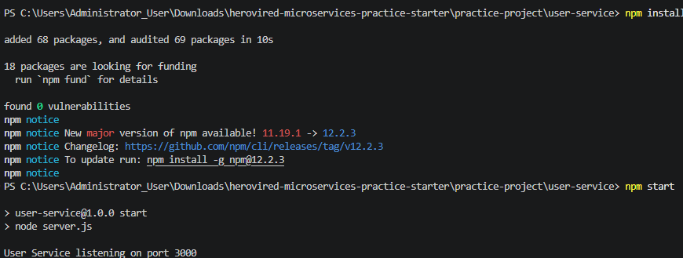

Test the User Service health endpoint from another terminal:

``` powershell
curl.exe http://localhost:3000/health
```

**Image 2 -- User Service health check**

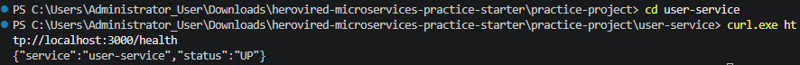

### 3.2 Start the Product Service

Open another terminal and run:

``` bash
cd product-service
npm install
npm start
```

The Product Service should start on port `3001`.

**Image 3 -- Product Service running locally**

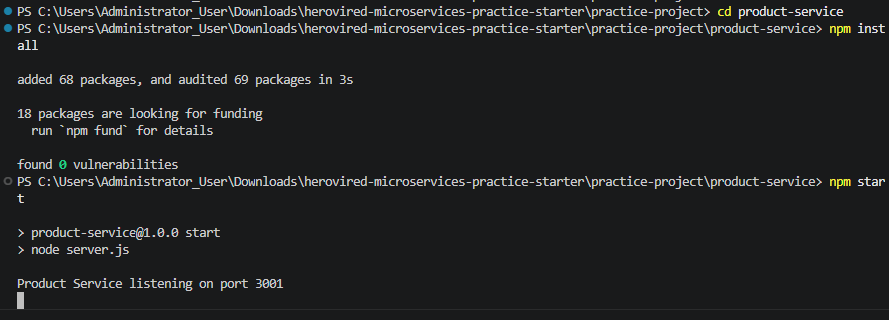

Test its health endpoint:

``` powershell
curl.exe http://localhost:3001/health
```

**Image 4 -- Product Service health check**

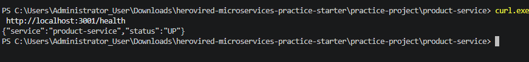

### 3.3 Start the Gateway Service

Open another terminal and run:

``` bash
cd gateway-service
npm install
npm start
```

The Gateway Service should start on port `3003`.

**Image 5 -- Gateway Service running locally**

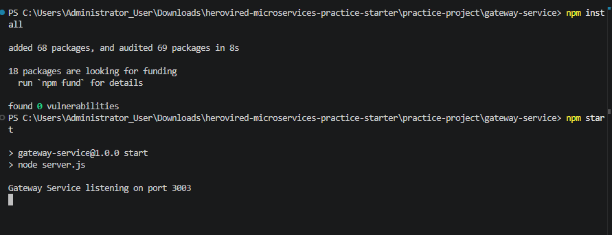

Test its health endpoint:

``` powershell
curl.exe http://localhost:3003/health
```

**Image 6 -- Gateway Service health check**

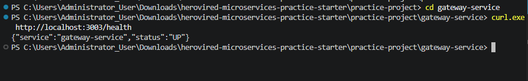

### 3.4 Test Gateway Access to Users and Products

Run the following commands to test whether the Gateway can fetch data
from the other services:

``` powershell
curl.exe http://localhost:3003/users
curl.exe http://localhost:3003/products
```

**Image 7 -- Initial Gateway users and products test**

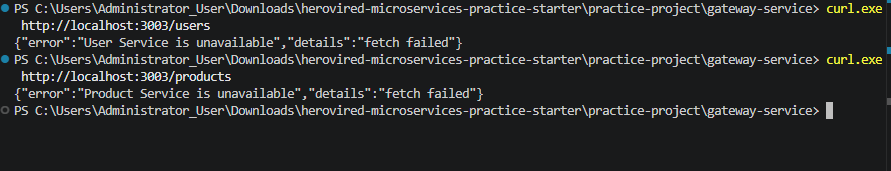

The Word document shows these requests returning
service-unavailable/fetch-failed responses at this stage. The services
are running separately, but their inter-service URL
configuration/connectivity needs to be addressed when they are run
together in Docker Compose.

## 4. Create Dockerfiles and Run Individual Containers

Create a separate Dockerfile inside each service folder.

### 4.1 User Service Dockerfile

Create `user-service/Dockerfile` with the following content:

``` dockerfile
# 1. Select Node.js base image
FROM node:20-alpine

# 2. Set working directory inside container
WORKDIR /app

# 3. Copy package files
COPY package*.json ./

# 4. Install application dependencies
RUN npm install --omit=dev

# 5. Copy application source code
COPY . .

# 6. Document application port
EXPOSE 3000

# 7. Start the application
CMD ["npm", "start"]
```

Build the Docker image:

``` bash
docker build -t user-service:v1 .
docker images
```

Run the container and map host port `3000` to container port `3000`:

``` bash
docker run -d --name user-container -p 3000:3000 user-service:v1
docker ps
```

**Image 8 -- User Service Docker container running**

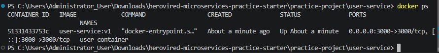

Test the container:

``` powershell
curl.exe http://localhost:3000/health
```

**Image 9 -- User Service health check in Docker**

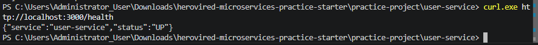

### 4.2 Product Service Dockerfile

Create `product-service/Dockerfile`:

``` dockerfile
# 1. Select Node.js base image
FROM node:20-alpine

# 2. Set working directory
WORKDIR /app

# 3. Copy package files
COPY package*.json ./

# 4. Install dependencies
RUN npm install --omit=dev

# 5. Copy application source code
COPY . .

# 6. Document container port
EXPOSE 3001

# 7. Start Product Service
CMD ["npm", "start"]
```

Build the image:

``` bash
docker build -t product-service:v1 .
docker images
```

Run the Product Service container:

``` bash
docker run -d --name product-container -p 3001:3001 product-service:v1
docker ps
```

**Image 10 -- Product Service Docker container started**

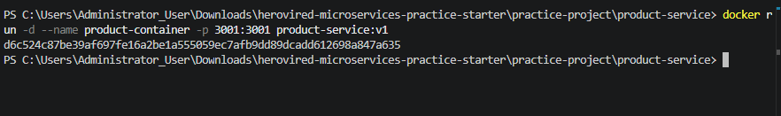

**Image 11 -- Docker containers list**

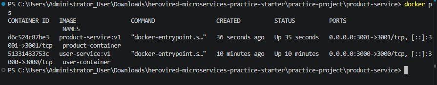

Test the Product Service health endpoint:

``` powershell
curl.exe http://localhost:3001/health
```

**Image 12 -- Product Service health check**

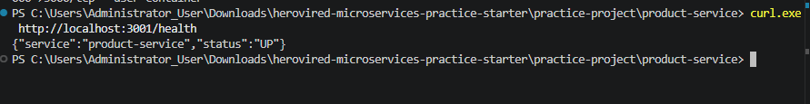

Test the products endpoint:

``` powershell
curl.exe http://localhost:3001/products
```

**Image 13 -- Product Service products endpoint**

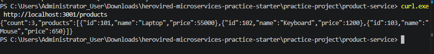

### 4.3 Gateway Service Dockerfile

Create `gateway-service/Dockerfile`:

``` dockerfile
# 1. Select Node.js base image
FROM node:20-alpine

# 2. Set working directory
WORKDIR /app

# 3. Copy package files
COPY package*.json ./

# 4. Install dependencies
RUN npm install --omit=dev

# 5. Copy application source code
COPY . .

# 6. Document Gateway port
EXPOSE 3003

# 7. Start Gateway Service
CMD ["npm", "start"]
```

Build the image:

``` bash
docker build -t gateway-service:v1 .
docker images
```

Run the Gateway container:

``` bash
docker run -d --name gateway-container -p 3003:3003 gateway-service:v1
docker ps
```

## 5. Stop and Remove Individual Containers

Before starting the services through Docker Compose, stop and remove the
individual containers created in the previous steps:

``` bash
docker stop user-container product-container gateway-container
docker rm user-container product-container gateway-container
```

**Image 14 -- Individual containers stopped and removed**

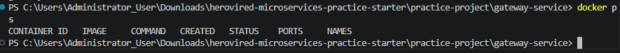

## 6. Create the Docker Compose File

Create `docker-compose.yml` in the project root directory.

``` yaml
services:

  # User Microservice
  user-service:
    build:
      context: ./user-service
      dockerfile: Dockerfile
    ports:
      - "3000:3000"
    networks:
      - microservices-network

  # Product Microservice
  product-service:
    build:
      context: ./product-service
      dockerfile: Dockerfile
    ports:
      - "3001:3001"
    networks:
      - microservices-network

  # Gateway Microservice
  gateway-service:
    build:
      context: ./gateway-service
      dockerfile: Dockerfile
    ports:
      - "3003:3003"
    environment:
      USER_SERVICE_URL: http://user-service:3000
      PRODUCT_SERVICE_URL: http://product-service:3001
    depends_on:
      - user-service
      - product-service
    networks:
      - microservices-network

# Create shared network
networks:
  microservices-network:
    driver: bridge
```

### Understanding the Docker Compose configuration

-   **services:** Defines the three application services.
-   **build.context:** Specifies the folder containing each service's
    Dockerfile and source code.
-   **ports:** Maps a host port to the corresponding container port.
-   **environment:** Supplies the internal service URLs to the Gateway.
-   **depends_on:** Starts the User and Product services before the
    Gateway service.
-   **networks:** Connects all three containers to the same Docker
    bridge network.
-   **microservices-network:** Allows containers to communicate using
    their Compose service names.

> Inside the Docker network, the Gateway uses `http://user-service:3000`
> and `http://product-service:3001`. These service names are resolved by
> Docker Compose. This is why the internal URLs use service names rather
> than `localhost`.

## 7. Validate, Build, and Start All Services

Validate the Compose configuration:

``` bash
docker compose config
```

Build the images and start all services in detached mode:

``` bash
docker compose up --build -d
```

Verify that all containers are running:

``` bash
docker compose ps
```

Verify the Docker networks:

``` bash
docker network ls
```

**Image 15 -- Docker network inspection**

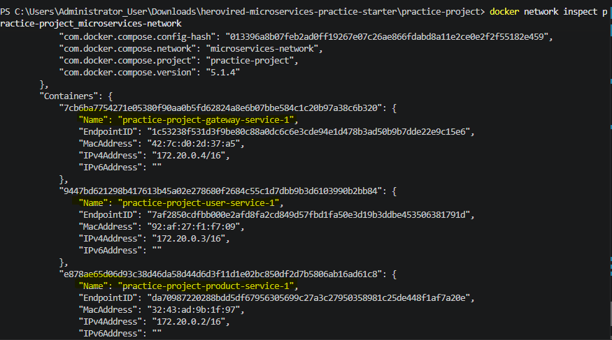

## 8. Test All Services

Use the following commands to test the health and data endpoints.

  Test               Command
  ------------------ -------------------------------------------
  User health        `curl.exe http://localhost:3000/health`
  User data          `curl.exe http://localhost:3000/users`
  Product health     `curl.exe http://localhost:3001/health`
  Product data       `curl.exe http://localhost:3001/products`
  Gateway health     `curl.exe http://localhost:3003/health`
  Gateway users      `curl.exe http://localhost:3003/users`
  Gateway products   `curl.exe http://localhost:3003/products`

## 9. Useful Docker Compose Commands

  Purpose                                  Command
  ---------------------------------------- --------------------------------
  View running Compose containers          `docker compose ps`
  View service logs                        `docker compose logs`
  Follow logs continuously                 `docker compose logs -f`
  Rebuild and start services               `docker compose up --build -d`
  Stop services                            `docker compose stop`
  Stop and remove containers and network   `docker compose down`

## 10. What We Practiced

Through this project, we practiced:

1.  Running Node.js microservices independently.
2.  Testing application health endpoints using `curl.exe`.
3.  Writing Dockerfiles for multiple Node.js services.
4.  Building Docker images with version tags.
5.  Running containers with port mapping.
6.  Checking images and running containers.
7.  Stopping and removing individual containers.
8.  Defining multiple services in `docker-compose.yml`.
9.  Configuring environment variables for service-to-service
    communication.
10. Creating a shared Docker bridge network.
11. Building and starting multiple containers with Docker Compose.
12. Testing service endpoints through host port mappings.

## 11. Conclusion

This project demonstrates how three independent Node.js microservices
can be containerized and managed together using Docker and Docker
Compose. Each service has its own Dockerfile, image, container, and port
mapping. Docker Compose brings the services together on a shared bridge
network and provides the Gateway with the internal URLs required to
communicate with the User and Product services.
